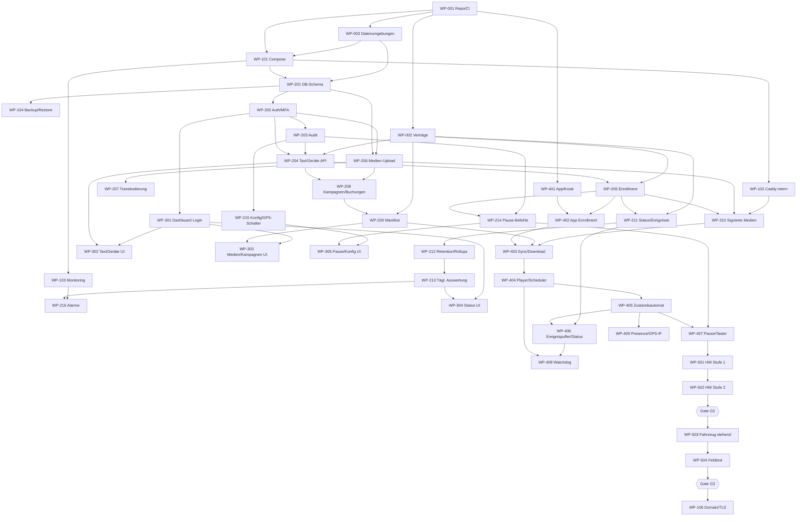

# Abhängigkeitsübersicht

Stand: 2026-11-09 · Ableitung aus `ARBEITSPAKETE.md`. „A → B" = B darf erst starten, wenn A `Done` ist.

## 1. Graph (Mermaid)

## 2. Kritischer Pfad bis zum ersten „Spot läuft auf einem Tablet"
WP-001 → WP-003 → WP-101 → WP-201 → WP-202 → WP-203 → WP-204 → WP-205 (+WP-002) → WP-206 → WP-208 → WP-209 → WP-210 → WP-401 → WP-402 → WP-403 → WP-404.
Parallel möglich: WP-103/104/105 (Infra), WP-301ff (Dashboard, nach Backend-Stand), WP-405ff (nach WP-404), WP-501 sobald erstes Testgerät und WP-405/407 vorliegen.

## 3. Entscheidungs-/Lückenabhängigkeiten (müssen vor WP-Freigabe geklärt sein)
| WP | Braucht Entscheidung/Information |
|---|---|
| WP-001 | A-05 (Technologie bestätigen), L-11 (GitHub, CI) |
| WP-005 | E57–E63 (Ausführungsort, Anbieter, Git-Stufe, Werkzeug, Budget, Vertraulichkeit, PC-Voraussetzungen); **blockiert** den Start jedes KI-Implementierungspakets (z. B. GT-ADS-001) |
| WP-002 | E36, L-03, L-07 |
| WP-201 | L-04, L-08 |
| WP-202/301 | L-05, L-07 |
| WP-206/207/404 | L-01 |
| WP-208/209 | L-03, L-04 |
| WP-212/213 | E22, K-03, K-06, L-07 |
| WP-214/405/407 | E36, E37, E40 |
| WP-216/103 | L-06, L-12 |
| WP-401/501 | L-02, E14, A-09 |
| WP-503 | E42, E43 (Gate G2) |
| WP-106/504 | E1, E2, E3 (Gate G3) |

## 4. Regeln
- Abhängigkeiten werden nur vom Planer geändert und im Katalog gespiegelt.
- Ein WP darf nicht gestartet werden, solange eine Abhängigkeit nicht `Done` oder eine Blockade nicht aufgelöst ist.
- Gates (G1–G4) sind Betreiberentscheidungen aus `ROADMAP.md`.
