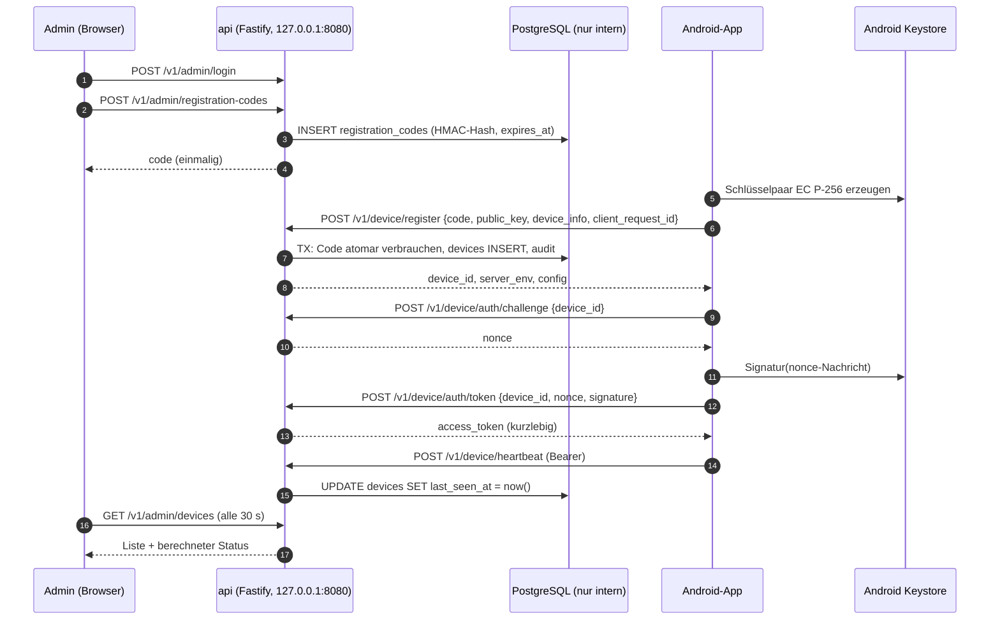

# GT-ADS-001 – Technischer Entwurf

Status: Entwurf zur Freigabe · Stand: 2026-11-09 · Basis: [SPEZIFIKATION.md](SPEZIFIKATION.md), [API-VERTRAG.md](API-VERTRAG.md), `docs/architektur/ARCHITEKTUR.md`, ADR-0001…0013.
**Technologievorbehalt:** Die Wahl TypeScript/Node/Fastify, React/Vite, Kotlin/Compose folgt ADR-0002 (🟦 **nicht bestätigt**, E47). Bei Änderung durch den Betreiber wird dieser Entwurf angepasst. Es werden **keine** zusätzlichen Technologien eingeführt (kein ORM, kein Redis, kein Queue-System, keine UI-Bibliothek außer React).

## 1. Systemüberblick

**Netzwerk (Testumgebung, keine öffentlichen Ports, E50):** Server bindet `127.0.0.1:8080`. Variante **T** (Vorschlag): Dev-Stack auf dem VPS; PC: `ssh -N -L 8080:127.0.0.1:8080 taxiwerbung`; Handy per USB: `adb reverse tcp:8080 tcp:8080`; App-URL `http://127.0.0.1:8080`. Variante **L:** Stack lokal auf dem PC (Docker nötig), nur `adb reverse`. Variante **W** (Tailscale) ist nicht vorgesehen, solange E28 offen. Deployment des Dev-Stacks auf den VPS nur durch den Betreiber (Docker braucht `sudo`; keine KI-Rechte).

## 2. Repository-Layout (neu angelegt von GT-ADS-001; Pfade verbindlich)
```
gt-ads/
├── package.json                      # npm-Workspaces: apps/api, apps/dashboard
├── .env.example                      # nur Platzhalter, keine Werte
├── contracts/gt-ads-001/             # maschinenlesbarer Vertrag (siehe API-VERTRAG.md §9)
│   ├── device-registration.openapi.yaml
│   ├── schemas/*.schema.json
│   └── examples/*.json               # synthetisch
├── apps/
│   ├── api/
│   │   ├── package.json  tsconfig.json  vitest.config.ts  Dockerfile
│   │   ├── scripts/hash-password.ts  # Admin-Passwort-Hash erzeugen (Passwort nie im Repo)
│   │   ├── src/
│   │   │   ├── index.ts              # Start, Konfig-Guard
│   │   │   ├── config.ts             # Umgebung validieren (GT_ADS_ENV ∈ dev|test)
│   │   │   ├── http/{server.ts,errors.ts,rateLimit.ts,logging.ts}
│   │   │   ├── db/{client.ts,migrate.ts}
│   │   │   ├── db/migrations/{0001_gt_ads_001.up.sql,0001_gt_ads_001.down.sql}
│   │   │   ├── crypto/{registrationCode.ts,tokens.ts,deviceSignature.ts,password.ts}
│   │   │   └── modules/
│   │   │       ├── registration/{routes.ts,service.ts,repository.ts}
│   │   │       ├── deviceAuth/{routes.ts,service.ts,repository.ts,middleware.ts}
│   │   │       ├── heartbeat/{routes.ts,service.ts}
│   │   │       ├── devices/{routes.ts,service.ts,repository.ts,status.ts}
│   │   │       ├── adminAuth/{routes.ts,service.ts,middleware.ts}
│   │   │       └── audit/{service.ts,repository.ts}
│   │   └── tests/{unit,integration,contract}/…
│   ├── dashboard/
│   │   ├── package.json  vite.config.ts  tsconfig.json  index.html
│   │   └── src/{main.tsx,App.tsx,api.ts,format.ts,pages/{LoginPage.tsx,DevicesPage.tsx},components/{CodeDialog.tsx,StatusChip.tsx,ConfirmDialog.tsx},tests/…}
│   └── android/
│       ├── settings.gradle.kts  build.gradle.kts  gradle/libs.versions.toml
│       └── app/
│           ├── build.gradle.kts
│           └── src/{main,debug,test,androidTest}/…   (Struktur §5)
└── infra/compose/{docker-compose.dev.yml,README.md}
```
Dateien außerhalb dieser Liste dürfen nicht geändert werden (außer `docs/fortschritt/**` laut Auftrag und `.gitignore`-Ergänzungen, falls nötig und im PR begründet).

## 3. Datenbank (PostgreSQL, Migration `0001`, vorwärts + Rückweg)
Namen `snake_case`, Zeiten `timestamptz` (UTC), IDs `uuid`. Keine Seeds in Migrationen (DATENTRENNUNG §2.2).
```sql
-- registration_codes: Klartext wird NIE gespeichert
registration_codes(
  id uuid primary key, code_hash bytea not null unique,       -- HMAC-SHA256(pepper, normalisierter Code)
  label text null, created_at timestamptz not null, created_by text not null,
  expires_at timestamptz not null, used_at timestamptz null, used_by_device_id uuid null,
  revoked_at timestamptz null, revoked_by text null)
devices(
  id uuid primary key, label text null,
  public_key_spki bytea not null, public_key_fingerprint text not null unique,   -- SHA-256 hex
  state text not null check (state in ('active','revoked')),
  manufacturer text not null, model text not null, os_version text not null, sdk_int integer not null,
  app_version text not null, app_flavor text not null,
  registration_code_id uuid not null references registration_codes(id),
  registration_request_id uuid not null,                       -- Idempotenz der Registrierung
  registered_at timestamptz not null, last_seen_at timestamptz not null,
  last_seq bigint not null default 0, last_clock_offset_ms bigint null,
  revoked_at timestamptz null, revoked_by text null)
device_auth_challenges(
  id uuid primary key, device_id uuid not null references devices(id),
  nonce_hash bytea not null, created_at timestamptz not null, expires_at timestamptz not null, used_at timestamptz null)
device_access_tokens(
  id uuid primary key, device_id uuid not null references devices(id),
  token_hash bytea not null unique, created_at timestamptz not null, expires_at timestamptz not null, revoked_at timestamptz null)
admin_sessions(
  id uuid primary key, token_hash bytea not null unique, created_at timestamptz not null, expires_at timestamptz not null)
audit_events(
  id bigint generated always as identity primary key, at timestamptz not null,
  actor_type text not null check (actor_type in ('admin','device','system')), actor_id text null,
  action text not null, target_type text null, target_id text null, details jsonb not null default '{}')
-- Indizes: devices(state), devices(last_seen_at), registration_codes(expires_at),
--          device_auth_challenges(expires_at), device_access_tokens(expires_at,device_id)
```
- `registration_codes.used_by_device_id → devices(id)` als deferrable FK oder ohne FK mit Constraint-Test (Implementierer wählt, im PR begründen; Zyklus beachten).
- **Kein** `taxi_id`; Zuordnung kommt per späterer Migration (WP-201/204). Keine Spalte für Standort.
- `audit_events.details` darf **keine** Codes, Tokens, Nonces, Signaturen, Passwörter enthalten (Test).
- **Bereinigung:** Beim Start und stündlich werden abgelaufene Challenges (> 24 h), Tokens (> 24 h) und Admin-Sitzungen gelöscht; Codes und Geräte bleiben (Nachvollziehbarkeit).
- **Down-Skript:** löscht alle neun Objekte dieser Migration; nur dev/test (Guard: Migration verweigert `down`, wenn `GT_ADS_ENV` nicht dev/test).

## 4. Backend-Module (Verantwortung, Schnittstellen)
| Modul | Aufgabe | Wichtige Regeln |
|---|---|---|
| `config` | Umgebung lesen/validieren | Start verweigert bei fehlendem/ungültigem `GT_ADS_ENV` oder `prod`; Pflichtgeheimnisse fehlen → Start verweigert (keine Defaults für Geheimnisse); Bind-Adresse Standard `127.0.0.1`, `0.0.0.0` nur mit expliziter Variable und Warnlog |
| `registration` | Code erzeugen/widerrufen/auflisten (Admin) und `register` (Gerät) | atomare Code-Einlösung in einer Transaktion; gleichförmige Fehler; Idempotenz via `client_request_id` |
| `crypto/registrationCode` | Erzeugen (CSPRNG), Normalisieren, HMAC | Alphabet `0123456789ABCDEFGHJKMNPQRSTVWXYZ`; Normalisierung: Großschreibung, Bindestriche/Leerzeichen entfernen, O→0, I/L→1 |
| `crypto/deviceSignature` | SPKI parsen, P-256 prüfen, ECDSA-SHA256 (DER) verifizieren | Kurve ≠ prime256v1 → ablehnen; Signaturnachricht exakt nach Vertrag |
| `deviceAuth` | Challenge ausstellen, Token ausstellen, Middleware | Nonce einmalig, TTL kurz; Token-Prüfung lädt Gerätezustand bei **jeder** Anfrage (Sperre sofort wirksam) |
| `heartbeat` | `last_seen_at` setzen, `last_seq`, `clock_offset` | Serverzeit; `seq ≤ last_seq` → 200, Zeit setzen, Werte nicht zurückdrehen |
| `devices` | Liste/Detail/Sperren, Statusableitung | Status zur Lesezeit (`status.ts` reine Funktion, testbar) |
| `adminAuth` | Login (ein Passwort **[E51]**), Session, Logout | scrypt-Vergleich zeitkonstant; Sitzungstoken zufällig, nur Hash in DB |
| `audit` | `audit_events` schreiben | nur über Service, nie mit Rohdaten aus Requests |
| `http` | Fehlerformat, Rate-Limit, Logging | Request-ID; Logs ohne Header `Authorization`/`Cookie` und ohne Body-Felder `registration_code`, `signature`, `public_key`, `password` |

**Rate-Limit (in-memory, Einzelinstanz-Annahme 🔧):** Registrierungsfehlversuche je Quelle und global; Admin-Login-Fehlversuche; bei Überschreitung 429 `rate_limited` mit `Retry-After`. Hinter Tunnel erscheinen alle Anfragen als eine Quelle → effektiv global; ausreichend für den Test, **nicht** für Produktion (Folgepaket).

## 5. Android-App (Kotlin, Jetpack Compose **[E47]**)
Paket-/App-ID **[A]**: `gtads.device` (neutral, keine Domain-Annahme; vor Release änderbar). `minSdk` **[E54]** Vorschlag 26 (Keystore EC ab API 23; WorkManager API 23+), nach Kenntnis der Handy-Android-Version bestätigen; `targetSdk` = aktuelle stabile Version laut Android-Studio-Standard.
```
app/src/main/
├── AndroidManifest.xml                 # nur <uses-permission INTERNET>; allowBackup=false; keine Standort/Kamera/Mikrofon
├── java/gtads/device/
│   ├── MainActivity.kt                 # Compose-Host, Navigation Registration ↔ Status
│   ├── ui/{RegistrationScreen.kt,StatusScreen.kt,Theme.kt}
│   ├── data/
│   │   ├── DeviceKeyManager.kt         # Keystore: EC P-256 erzeugen, signieren, löschen
│   │   ├── ApiClient.kt                # OkHttp + kotlinx.serialization, Fehler → ApiError
│   │   ├── ApiModels.kt  ApiError.kt
│   │   ├── AuthManager.kt              # Challenge/Token, Token nur im Speicher, Erneuerung bei 401
│   │   └── DeviceStore.kt              # DataStore: device_id, Zustand, letzter Erfolg/Fehler, seq
│   ├── domain/{RegistrationUseCase.kt,HeartbeatUseCase.kt,SignatureMessage.kt}
│   └── work/{HeartbeatWorker.kt,HeartbeatScheduler.kt}
├── res/…                               # Texte Deutsch
app/src/debug/res/xml/network_security_config.xml    # Klartext NUR 127.0.0.1/localhost
app/src/test/…      # JVM-Unit-Tests
app/src/androidTest/… # Instrumentierte Tests (Gerät/Emulator)
```
- **Keystore-Schlüssel:** Alias `gt-ads-device-key`, `KeyProperties.PURPOSE_SIGN`, `EC secp256r1`, `DIGEST_SHA256`, nicht exportierbar, **keine** Nutzerauthentifizierung erforderlich, StrongBox bevorzugt wenn verfügbar, sonst TEE (Fallback protokolliert, nicht blockierend).
- **Speicherung:** `device_id` und Statusfelder in DataStore (keine Geheimnisse). Access-Token **nur im Speicher**; nach Prozessende neu per Challenge holen.
- **Heartbeat:** (a) direkt nach erfolgreicher Registrierung, (b) bei App-Vordergrund (`ON_RESUME`), (c) periodisch `PeriodicWorkRequest` ≥ 15 min mit Intervall aus Serverkonfiguration (Untergrenze 15 min, 🔧), (d) Debug-Knopf „Jetzt senden". Netzwerk-Constraint `CONNECTED`; Backoff exponentiell.
- **Zustände der App-UI:** `NICHT_REGISTRIERT` (Code-Eingabe) · `REGISTRIERUNG_LÄUFT` · `REGISTRIERT` (Geräte-ID gekürzt, letzter erfolgreicher Kontakt, letzter Fehler, Server-Umgebung) · `GESPERRT` (Hinweis, Neu-Registrierung möglich → löscht Schlüssel und lokalen Zustand). **Nur Debug-Build:** Menüpunkt „Registrierung zurücksetzen" (löscht Schlüssel und lokalen Zustand, ohne Serveraktion) und Knopf „Jetzt senden".
- **Fehlerverhalten:** Netzfehler/Timeout → freundlicher Hinweis, Retry; `invalid_registration_code` → „Code ungültig oder abgelaufen"; `rate_limited` → Wartezeit anzeigen; `environment_mismatch` → klare Meldung; `device_revoked` → `GESPERRT`.
- **Build-Konfiguration:** `gtads.apiBaseUrl` (Gradle-Property/`local.properties`, nicht committet) Standard `http://127.0.0.1:8080`; `APP_ENV=dev`. Release-Build: `usesCleartextTraffic=false`, URL muss `https://` sein (Build bricht sonst ab).

## 6. Sicherheitsarchitektur (Bedrohung → Gegenmaßnahme)
| Bedrohung | Gegenmaßnahme | Test |
|---|---|---|
| Code erraten (Brute Force) | 60-Bit-Code, TTL 15 min, Rate-Limit je Quelle + global, gleichförmige Fehler | Unit/Integration (Rate-Limit, Uniformität) |
| Code abgegriffen/wiederverwendet | Einmalverwendung per `UPDATE … WHERE used_at IS NULL … RETURNING`, Hash-Speicher, kurze TTL | Parallel-Test (Race) |
| Datenbank-Leck | Codes/Tokens/Nonces nur als Hash; öffentliche Schlüssel unkritisch | Schema-Test, Log-/DB-Scan |
| Token-Diebstahl | kurze TTL, Token nur im Speicher, Neu-Auth per Signatur, Sperre sofort | Integration |
| Replay von Challenge | Nonce einmalig + 60 s | Integration |
| Gefälschtes Gerät ohne Schlüssel | Signaturprüfung P-256 | Unit |
| Schlüssel aus Gerät kopieren | Keystore, nicht exportierbar (Attestation = V2, bekannte Lücke) | Instrumentierter Test |
| Falsche Systemzeit am Gerät | Serverzeit maßgeblich, Offset nur geloggt | Integration/manuell |
| Admin-Zugang erraten | scrypt, Rate-Limit, Sitzung kurz, nur lokal erreichbar | Unit/Integration |
| CSRF auf Admin-API | Cookie `SameSite=Strict`, nur `application/json`, Ursprungs-/`Origin`-Prüfung | Integration |
| XSS im Dashboard | React-Escaping, keine `dangerouslySetInnerHTML`, CSP-Header `default-src 'self'`, Labels als Text | Dashboard-Test |
| Test-App an Produktion | Umgebungsvergleich `app_env` ↔ `GT_ADS_ENV`; Server startet nicht mit `prod` | Integration |
| Klartextverkehr | nur Debug+localhost; Release verbietet | statische Prüfung |
| Offene Ports | Bindung 127.0.0.1; Compose publiziert nur `127.0.0.1:8080`; DB nicht publiziert | Compose-Check |
| Geheimnisse in Git | `.env.example` ohne Werte, `.gitignore`, Secret-Scan | Scan |
Restrisiken: siehe SPEZIFIKATION §8 (K-12 Klartext, K-13 kein MFA, keine Key Attestation).

## 7. Dashboard (React + Vite, TypeScript)
- Auslieferung: `apps/api` serviert den gebauten Dashboard-Ordner statisch unter `/` (gleicher Ursprung → kein CORS). In der Entwicklung proxyt Vite `/v1` → `127.0.0.1:8080`.
- **Seiten:** `LoginPage` (Passwortfeld, Fehlermeldung generisch) · `DevicesPage`.
- **DevicesPage (Minimum):** Tabelle mit Spalten: Label · Gerät (Hersteller + Modell) · Android (`os_version`, API-Level) · App-Version · Status-Chip (`Erreichbar`/`Zuletzt gesehen`) · Letzter Kontakt (absolut `Europe/Vienna` + „vor …") · Registriert am · Zustand (`Aktiv`/`Gesperrt`) · Aktion „Sperren" (mit Bestätigungsdialog). Kopf: Zähler (Anzahl Geräte, erreichbar), Button „Registrierungscode erzeugen", Refresh-Knopf, Auto-Refresh 30 s **[A]**, Zeit des letzten Updates.
- **CodeDialog:** optionales Label → zeigt den Code **einmal** (gruppiert `XXXX-XXXX-XXXX`), Ablaufzeit mit Countdown, Hinweis „Code wird nicht erneut angezeigt"; Liste offener Codes (Status offen/benutzt/abgelaufen/widerrufen, kein Klartext) mit „Widerrufen".
- **Leerer Zustand:** „Noch keine Geräte registriert." **Keine** Demo-Daten, keine Platzhalterzeilen.
- **Texte:** Deutsch; Status nie „offline/defekt/ausgeschaltet"; Tooltip laut SPEZIFIKATION §6.
- Keine externen Skripte/Fonts/CDNs; keine Telemetrie.

## 8. Betrieb der Testumgebung
`infra/compose/docker-compose.dev.yml`: Dienste `db` (PostgreSQL 17, **konkreten 17.x-Tag** beim Implementieren festlegen, kein `latest`, nicht nach außen veröffentlicht, benannter Volume), `api` (Port nur `127.0.0.1:8080:8080`, `GT_ADS_ENV=dev`), Ressourcenlimits **[A]** db 1 GB, api 512 MB. Zugangsdaten über `.env` (nicht im Repo). Testdatenbank für automatisierte Tests: separater Datenbankname `gt_ads_test`, pro Lauf neu erzeugt und verworfen. Kein Seed. Zurücksetzen: `docker compose down -v` (zerstört nur Dev-Daten).

## 9. Entscheidungen dieses Entwurfs (technisch, rückholbar)
| # | Entscheidung | Begründung | Alternative |
|---|---|---|---|
| T1 | Challenge-Response statt statischem Gerätegeheimnis | S-01, kein Geheimnis auf dem Gerät | mTLS (zu schwer ohne TLS/Domain) |
| T2 | ECDSA P-256 | breit im Android Keystore unterstützt | Ed25519 (erst neue Android-Versionen) |
| T3 | Opaque Tokens, nur Hash in DB | sofort widerrufbar | JWT (Widerruf schwerer) |
| T4 | Kein ORM, handgeschriebenes SQL | wenige Tabellen, keine neue Technologie | Drizzle (ADR-0002, offen) |
| T5 | API liefert Dashboard statisch | ein Port, kein CORS | Caddy (WP-102) |
| T6 | Statusableitung zur Lesezeit | keine Hintergrundjobs, Zeitgrenzen testbar | gespeicherter Status |
| T7 | Heartbeat ohne Puffer | Nicht-Ziel Ereignisse | Pufferung (WP-406) |
| T8 | In-Memory-Rate-Limit | Einzelinstanz-Test | DB-/Redis-Limit (später) |
