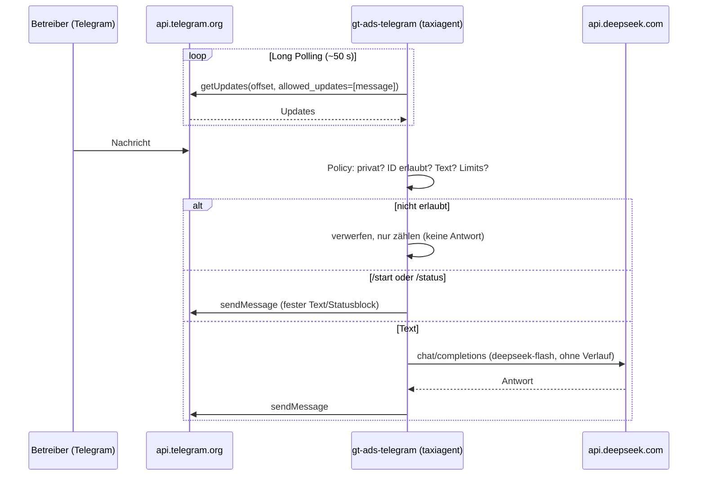

# WP-006 – Technischer Entwurf

Status: Entwurf zur Freigabe · Stand: 2026-11-09 · Basis: [SPEZIFIKATION.md](SPEZIFIKATION.md), [API-VERTRAG.md](API-VERTRAG.md). Technologie: **Python 3.12 (auf dem VPS vorhanden), ausschließlich Standardbibliothek** (`urllib`, `ssl`, `json`, `tomllib`, `logging`, `unittest`).

## 1. Ablauf

Nur ausgehende HTTPS-Verbindungen. Kein Listener, kein Webhook, kein Port.

## 2. Dateilayout (verbindlich; nur diese Pfade neu anlegen)
```
apps/telegram-gateway/
├── README.md                      # Zweck, Grenzen, Betrieb, Tests
├── gtads_tg/
│   ├── __init__.py  main.py       # Start, Konfig-Guard, Poll-Schleife, Signale
│   ├── config.py                  # TOML lesen/validieren; Geheimnisse nur aus $CREDENTIALS_DIRECTORY
│   ├── telegram.py                # Client: getUpdates, sendMessage, deleteWebhook (feste Basis-URL)
│   ├── deepseek.py                # Client: chat/completions (feste Basis-URL)
│   ├── policy.py                  # Absenderprüfung, Update-Filter, Ratenlimit, Tageslimit
│   ├── commands.py                # /start, /status, Textnachricht
│   ├── state.py                   # Zähler/Zeitstempel; Zustandsdatei (nur Metadaten)
│   └── redact.py                  # Redaktion von Token/URLs in Logs und Fehlern
├── tests/{test_policy.py,test_commands.py,test_redact.py,test_limits.py,test_clients.py,test_integration.py,test_static.py}
├── config/telegram-gateway.toml.example
└── deploy/
    ├── gt-ads-telegram.service    # Unit-Vorlage (gehärtet)
    ├── install.sh  uninstall.sh   # nur vom Betreiber mit sudo; Trockenlauf-Option
    ├── set-credential.sh          # versteckter Prompt, schreibt root-eigene Credential-Datei
    └── README.md                  # Schritte S5, Rollback, Prüfbefehle
```
Außerhalb dieser Pfade ändert das Paket nur `docs/**` (Status/Protokoll).

## 3. Module (Verantwortung, Regeln)
| Modul | Verantwortung | Regeln |
|---|---|---|
| `config` | Lädt TOML, prüft Typen/Grenzen, liest Geheimnisse aus `$CREDENTIALS_DIRECTORY/{telegram_bot_token,deepseek_api_key}` | fehlt etwas → Start verweigert; kein Geheimnis in Konfig/Umgebung/Argumenten; Normalmodus ohne `allowed_user_id` → Start verweigert |
| `telegram` | `getUpdates` (Offset, `timeout=50`, `allowed_updates=["message"]`), `sendMessage` (reiner Text, ohne `parse_mode`), einmal `deleteWebhook` beim Start | feste Basis-URL; Token nur im Pfad, nie geloggt; Fehler werden redigiert |
| `deepseek` | `POST /chat/completions` (Modell, Systemprompt, genau eine Nutzernachricht, `max_tokens`, `stream=false`) | feste Basis-URL; Timeout; 401/402/429/5xx → definierte Fehlerklassen; Antworttext gekürzt auf Telegram-Limit (4096 Zeichen) |
| `policy` | Entscheidet je Update: verarbeiten oder verwerfen | siehe §5; Ratenlimit (gleitendes Fenster), Tageslimit (Zähler pro lokaler Kalendertag `Europe/Vienna`) |
| `commands` | `/start`, `/status`, Text → Modell | `/status`: nur Felder aus API-VERTRAG §3 |
| `state` | Zähler, Zeitstempel, Störungsphase | Zustandsdatei JSON ohne Inhalte, atomar geschrieben, nur in `/srv/taxiagents/telegram/state/` |
| `redact` | Ersetzt Telegram-Tokenmuster `\d+:[A-Za-z0-9_-]{30,}`, DeepSeek-Schlüsselmuster, Bearer-Header in Logs/Exceptions | wird in **allen** Logpfaden verwendet; Test erzwingt es |

## 4. Betrieb und Härtung (systemd, Unit-Vorlage)
`User=taxiagent`, `Group=taxiagent`, `Type=simple`, `ExecStart=/usr/bin/python3 -I -m gtads_tg.main` mit `WorkingDirectory=/opt/gt-ads/telegram-gateway` (**Code root-eigen, 0755/0644, für `taxiagent` nur lesbar**), `LoadCredential=telegram_bot_token:/etc/gt-ads/credentials/telegram_bot_token`, `LoadCredential=deepseek_api_key:/etc/gt-ads/credentials/deepseek_api_key`, `Environment=PYTHONDONTWRITEBYTECODE=1`, `Restart=on-failure`, `RestartSec=10`, `After=network-online.target`, `Wants=network-online.target`, `WantedBy=multi-user.target`.
Sandbox **[A]**: `NoNewPrivileges=yes`, `ProtectSystem=strict`, `ProtectHome=yes`, `PrivateTmp=yes`, `PrivateDevices=yes`, `ProtectKernelTunables=yes`, `ProtectKernelModules=yes`, `ProtectControlGroups=yes`, `ProtectClock=yes`, `ProtectHostname=yes`, `RestrictAddressFamilies=AF_INET AF_INET6`, `RestrictNamespaces=yes`, `LockPersonality=yes`, `MemoryDenyWriteExecute=yes`, `RestrictRealtime=yes`, `RestrictSUIDSGID=yes`, `CapabilityBoundingSet=` (leer), `SystemCallFilter=@system-service`, `SystemCallArchitectures=native`, `ReadWritePaths=/srv/taxiagents/telegram/state`, `InaccessiblePaths=/srv/taxiwerbung /home /root`, `MemoryMax=256M`, `CPUQuota=25%`, `TasksMax=32`. Abgleich per `systemd-analyze security gt-ads-telegram` (Ergebnis dokumentieren; Ausnahmen begründen). **Keine** `IPAddressAllow`-Regeln in Phase 1 (IP-basierte Listen für Telegram/DeepSeek instabil); stattdessen Codeebene (feste Hosts, kein Werkzeug).

## 5. Policy im Detail
Verarbeitet wird ein Update genau dann, wenn: `message` vorhanden · `chat.type == "private"` · `from.is_bot == false` · `from.id == allowed_user_id` · `text` vorhanden (Länge ≤ `max_input_chars`, sonst Kurzantwort „zu lang") · nicht weitergeleitet von Dritten (`forward_*` → verwerfen) · Ratenlimit/Tageslimit nicht überschritten. **Alles andere:** keine Antwort, Zähler `dropped` +1 (nach Grund-Kategorie ohne personenbezogene Werte). Im **Normalmodus** gibt es keinen Pfad, der Nachrichten Fremder beantwortet.

## 6. Setup-Modus (nur zur Ermittlung der ID, E68)
Start mit `--setup` (nur durch Betreiber, per `systemctl start gt-ads-telegram-setup` oder einmaliger Aufruf). Verhalten: pollt höchstens `setup_mode_max_s` (600 s), schreibt für **jede private Nachricht nur die numerische Absender-ID** und die Uhrzeit ins Journal, **antwortet nicht**, speichert keine Inhalte; danach Selbstbeendigung. Der Betreiber sendet in diesem Fenster eine bekannte Nachricht, liest die ID zur Uhrzeit aus dem Journal und trägt sie in die Konfiguration ein. Der Setup-Modus darf **nicht** automatisch starten; der Normalmodus startet ohne ID nicht.

## 7. Zugangsdaten (Betreiberablauf)
`set-credential.sh <name>`: liest den Wert per `read -rs` (keine Anzeige, keine History), prüft grob das Format (ohne Ausgabe), schreibt nach `/etc/gt-ads/credentials/<name>` mit `umask 077`, Eigentümer `root:root`, Modus 0600; optional Gültigkeitsprüfung (`getMe` bzw. Mini-Aufruf) mit Aufruf per `curl -K -` (Konfiguration über stdin, damit der Wert nicht in der Prozessliste erscheint). Rotation = Skript erneut ausführen + `systemctl restart`. Widerruf: beim Anbieter (BotFather `/revoke`, DeepSeek-Konsole) und Datei löschen.

## 8. Technische Entscheidungen (rückholbar)
| # | Entscheidung | Begründung | Alternative |
|---|---|---|---|
| T1 | Python-Standardbibliothek | auf VPS vorhanden, keine Lieferkette | OpenClaw/Node (E69 = O) |
| T2 | Kein Gesprächsverlauf | E72 „keine Inhalte speichern", kleiner Umfang | Kurzzeitgedächtnis im RAM (später) |
| T3 | Feste Zielhosts im Code | Exfiltrationsbegrenzung ohne Firewall | Egress-Proxy/UID-Regeln (privilegiert, später) |
| T4 | Code root-eigen | Agent kann eigenen Code nicht verändern | Code im Home von `taxiagent` (verworfen) |
| T5 | systemd-Credentials | Geheimnis für den Dienstbenutzer nicht als Datei lesbar | Datei 0600 `taxiagent` |
| T6 | Ein Prozess, eine Schleife | einfach, auditierbar | Threads/async (unnötig) |
